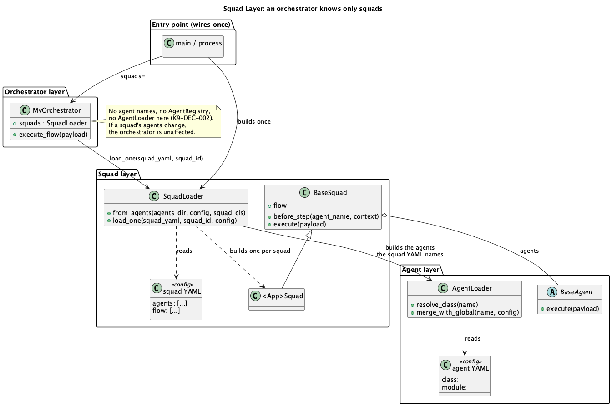

# Squad Layer Pattern

## Intent

Keep an orchestrator's knowledge to **squads only**. The agents a squad needs are named in the squad's own configuration and built by the squad layer, so **if a squad's agents change, no orchestrator changes**.

---

## Motivation

Three-layer decoupling says each layer knows only the layer below it: a router knows orchestrators, an orchestrator knows squads, a squad knows agents.

The common way to break it is quiet: the orchestrator *builds its squads' agents*. It does not import them; it lists their names, fills an agent registry and hands that to a squad loader. Import checks pass, yet every change to a squad's team means editing the orchestrator, and the habit spreads from one orchestrator to the next.

The Squad Layer pattern gives agent construction to the layer that owns the team: the squad layer.

---

## Structure



| Element | Role |
|---|---|
| **Squad YAML** | *What* a squad is: its agents, its flow (and, optionally, context synthesis). |
| **Squad loader** (`SquadLoader.from_agents`) | *Builds* a squad and the agents its YAML names, resolving each agent through its own YAML (`class:` + `module:`). |
| **BaseSquad** | *Runs* the flow; any squad, no code of its own. |
| **One `<App>Squad`** (optional) | Squad-level behaviour for the whole application, e.g. `before_step` (stop a withdrawn job). Instantiated once per squad, with that squad's agents. |
| **Entry point** | Builds the squad loader **once** and passes it to every orchestrator. |
| **Orchestrator** | `self.squads.load_one(squad_yaml, squad_id)` — squads only. |

---

## Implementation (K9-AIF 1.18.1)

```python
# entry point: wires the layers once
squads = SquadLoader.from_agents(AGENTS_DIR, config=config, squad_cls=MyAppSquad)
orchestrator = ClaimsOrchestrator(config=config, squads=squads)

# orchestrator: squad file and id, nothing else
class ClaimsOrchestrator(BaseOrchestrator):
    def execute_flow(self, payload):
        squad = self.squads.load_one(SQUADS_DIR / "claims_squad.yaml", "ClaimsSquad")
        return squad.execute(payload)

# optional: one class for every squad of the application
class MyAppSquad(BaseSquad):
    def before_step(self, agent_name, context):
        if job_withdrawn(context.get("job_id")):
            raise JobWithdrawn(agent_name)
```

```yaml
# squads/claims_squad.yaml — the squad's team lives here
squads:
  ClaimsSquad:
    agents: [IntakeAgent, CoverageAgent, ReviewAgent]
    flow:
      - agent: IntakeAgent
        result_key: intake
      - agent: CoverageAgent
        result_key: coverage
      - agent: ReviewAgent
        result_key: review
```

A per-run configuration (for example a governance override on a resumed run) reaches the agents through `load_one(..., config=run_config)`, without the orchestrator knowing which agents it touches.

---

## Anti-pattern

```python
# The orchestrator knows agents without importing one
class ClaimsOrchestrator(BaseOrchestrator):
    AGENTS = ("IntakeAgent", "CoverageAgent", "ReviewAgent")
    def _load_squad(self, path, squad_id):
        registry = AgentRegistry()
        AgentLoader(AGENTS_DIR).register_into(registry, self.config, self.AGENTS)
        return SquadLoader(registry).load_one(path, squad_id)
```

---

## Consequences

- Adding, removing or replacing an agent changes the squad YAML (and that agent's own YAML and class) — never an orchestrator.
- Squads need no Python of their own; squad-level behaviour lives in one class.
- The rule is checkable: in K9-AIF, `k9aif inspect` rule **K9-DEC-002** reports an orchestrator that names agents or builds an agent registry, and a framework test adds an agent to a squad and runs the unchanged orchestrator.

## Tradeoffs

- One more object to wire at the entry point.
- Agent construction errors surface when a squad loads, not when the orchestrator is created.

---

## Usage in K9-AIF

`SquadLoader.from_agents`, `BaseSquad.before_step`, `BaseOrchestrator(squads=)` (K9-AIF 1.18.1). Used by DAS (`DasSquad`, one class for its nine squads) and generated by the `k9aif new` scaffold. Related: [Agent Squad Pattern](../agent-squad-pattern/README.md), [Runtime Agent Loader Pattern](../runtime-agent-loader-pattern/README.md).
